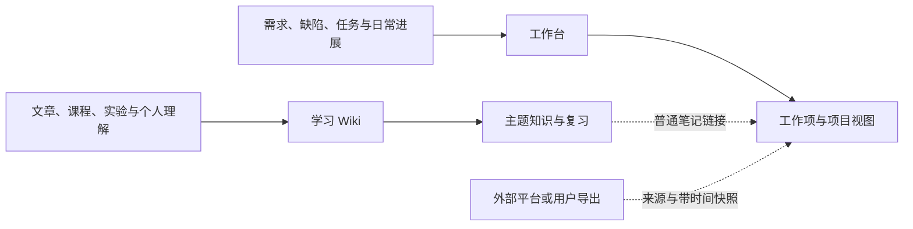

# Obsidian：学习 Wiki 与独立工作台

设计日期：2026-10-15。学习是主要用途；工作侧用于把需求、缺陷、任务分工和日常进展记清楚。
两个 skill 各自完整运行，不互相调用，不要求安装 PingCode skill，也不把任何外部服务当作前置条件。

## 调研结论与选择

Karpathy 在 2026-04-04 发布的 [LLM Wiki 原文](https://gist.github.com/karpathy/442a6bf555914893e9891c11519de94f)
提出保留来源、持续整合知识、查询与维护的模式；它是可定制的理念文件，不是官方固定产品。
这次采用其增量整合思路，并针对现有手写笔记增加个人理解保护、证据区分和只读查询边界。

| 可借鉴的路线 | 实际用途 | 本次取舍 |
| --- | --- | --- |
| [Basic Memory](https://github.com/basicmachines-co/basic-memory) | 让人和 AI 读写 Markdown 并建立检索关联 | 借鉴文件为主、索引辅助；没有跨客户端记忆服务需求时不新增服务 |
| [QMD](https://github.com/tobi/qmd) | 本地全文、语义与重排检索 | 搜索确实成为瓶颈时再评估；当前不作为必需依赖 |
| [GraphRAG](https://microsoft.github.io/graphrag/query/overview/) | 结合图、原文片段与社区摘要支持不同查询 | 不把 RAG 与 Wiki 对立；当前无需为个人学习引入图处理管线 |
| [Obsidian Bases](https://obsidian.md/help/bases) | 按本地笔记属性形成可筛选、可编辑的视图 | 可用来查看需求、缺陷和任务，数据仍在原笔记中 |
| [Obsidian 格式工具集](https://github.com/kepano/obsidian-skills) | Markdown、Bases、Canvas、CLI 等格式与操作能力 | 可独立选择；本次个人工作流不导入或依赖该工具集 |

表中的取舍是针对本次需求的设计判断，不是这些项目作者给本知识库的保证。
文件留在本地不代表调用的 AI 服务也在本地；本设计不承诺整个处理链离线。

## 两个独立入口

| 维度 | 学习 Wiki | 工作台 |
| --- | --- | --- |
| 核心问题 | 我理解了什么，依据是什么，如何应用 | 什么要做、谁来做、做到哪、怎样算完成 |
| 主体内容 | 来源、概念、机制、比较、实践、自己的理解 | 需求、缺陷、任务、工作事件 |
| 常用动作 | 吸收、提问、复习、核对与更新 | 建项、拆分、记录分工、更新状态、日常及周期汇总 |
| 判断成效 | 能解释、举例、应用，关键结论可追溯 | 同一事项不重复，负责人和下一步清楚，状态有依据 |
| 外部依赖 | 无；现有文件搜索即可开始 | 无；粘贴材料或导出文件也能记录 |
| 关联方式 | 普通笔记链接 | 普通笔记链接、真实外部 ID/URL 与快照时间 |

学习入口统一为 `obsidian-wiki`，中文展示为“Obsidian 学习 Wiki”；工作入口统一为 `obsidian-work`，中文展示为“Obsidian 工作台”。
目录、显式调用、文档与安装入口使用相同标识；发布是工作台中的一种记录类型。

虚线表示数据引用，不是 skill 调用、自动同步或后台任务。

## 学习的完整过程

1. 带着问题收材料；已知主题直接更新，尚未决定的才进 Inbox。
2. 查已有内容和来源身份，判断材料是重复、增量、版本变化还是分歧。
3. 更新能独立解释问题的知识页，保留个人理解，给重要结论可回查的证据。
4. 用提问、解释和小应用练习检验理解；查询和出题默认不写入。
5. 遇到新证据核对适用条件，修订当前结论，保留必要的更正原因。

不是每篇文章都值得一篇摘要，也不是每个名词都值得一个实体页。
学习来源与知识属于不同内容角色，不强制对应固定目录。

### 写作与知识更新的分工

文章结构由学习问题和现有理解决定。命名、属性和链接保持兼容；旧资源模板里的通用章节、
固定代码示例与配图清单不再作为正文要求。段落推进解释，表格用于比较，图用于说明关系。
相似问题可以有相似结构，避免为了形式差异打乱有用顺序。

新证据落到具体判断：区分重复、补充、纠错、条件变化和未决冲突，再同步本页中的代码、图、摘要
及直接依赖它的知识页。维护旧版本与学习最新版本分别处理，历史实验不冒充新版本验证。
局部复核说明局部范围，不能只核实一个 API 就给整页盖上新的核验日期。
流程见 [知识更新](../skills/obsidian-wiki/references/knowledge-updates.md)。

## 工作台怎样借鉴项目管理工具

需要独立负责人、状态和验收的事项单独成页；一次性小待办留在清单里。
需求写目标、范围和验收；缺陷写环境、复现、预期与实际；任务写动作、负责人和交付标准。
项目主页提供入口，日常日志记录变化，周报保留当时的汇总，不另造一套“当前状态”真相。

本地与外部系统的区别：

| 情形 | 谁是主档 | 本地记录方式 |
| --- | --- | --- |
| 个人需求、缺陷、任务 | Obsidian | 本地状态、负责人、验收与进展 |
| 已在外部团队平台维护的事项 | 外部平台 | 来源 ID/URL、观察到的状态与来源时点，明确是快照 |
| 自己对外部事项的跟进 | Obsidian | 独立个人任务，通过链接引用外部事项 |

例如团队缺陷仍“处理中”，个人任务“完成排查并整理建议”可以已完成。
勾选个人任务不会关闭团队缺陷，写下负责人不会通知或指派对方。
重复导入先按来源、项目和实际 ID 匹配；今日读取旧导出不代表外部状态是今日最新。
只有用户明确要求远端操作时，才由当次可用工具独立执行并核验；这不成为本地 skill 的运行依赖。

## 保留 PARA，但降低整理成本

- Projects 放有交付边界的工作和项目资料；Areas 放长期职责；Resources 放可复用学习知识。
- 已有来源目录、附件和手写笔记继续使用；没有需要就不增建 raw/wiki 层级。
- 导航入口按实际查找和学习路径建立，取消“达到固定篇数就建 MOC”。
- 旧笔记遇到时逐步补信息，不批量改名、补字段或宣布无来源内容已被验证。
- 学习页可以引用工作事件，工作项也可以引用知识；这不要求另一个 skill 存在。

## Bases 工作台与验证边界

Bases 可将一篇工作项笔记的一组属性展示为一行，避免复制维护汇总表。
属性及视图语法以 [Properties](https://obsidian.md/help/properties) 和 [Bases syntax](https://obsidian.md/help/bases/syntax) 为准。
本次已接入 Obsidian 核心 Bases：首页含分类卡片、待推进与近期记录，并提供 8 个视图、5 份模板。
资产位于 [工作台资源](../skills/obsidian-work/assets/workbench/)，接入方式见
[视图说明](../skills/obsidian-work/references/bases-views.md)。普通记录仍可直接使用 Markdown。

已在 Obsidian 1.14.4 检查深浅主题、宽窄面板和原生表格。临时验收数据覆盖未知及缺失状态、
缺主档归属、外部快照、已完成任务、日常记录、负责人分组、日期排序及属性编辑回写。
实测修正了空字段漏入“待整理”的条件：缺失值用 `isEmpty()` 判断。
验收数据不作为真实工作项保留；已有工作笔记只按真实需要逐步接入。

结构脚本继续检查链接目标、路径和兼容发版格式；它们不判断知识正确、状态真实或任务已验收。
学习的行为验证使用隔离材料，工作台另验证脱离其他 skill 后的独立运行。
试用时观察实际找资料、解释问题与更新工作的效果，再决定是否增加检索或更复杂的项目管理能力。
