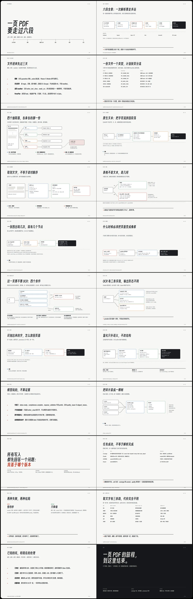
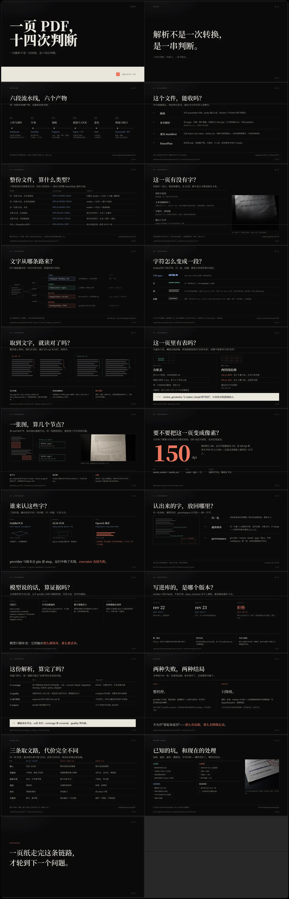
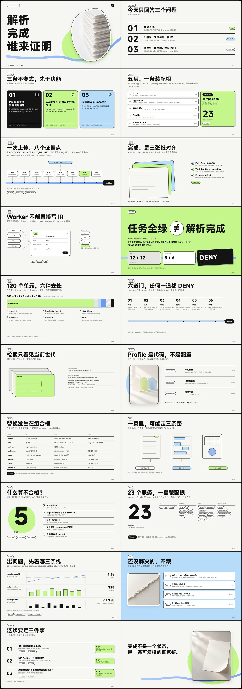

# deck-authoring · 演示文稿制作

从材料组织内容、设计版面与配图，制作 HTML 演示并导出 PDF、PNG、PPTX 或逐页视频。
新项目使用自由 HTML / CSS，页面按内容构图；已有 spec 项目保留兼容制作和有限的原生可编辑导出。
使用入口见 [SKILL.md](SKILL.md)。

## 成品示例

同一类技术材料，可以形成完全不同的视觉方向。下面三份演示由本 skill 制作，截图是整份 deck
的联系表（contact sheet），点击可看大图；图中的项目名已隐去。字体、配色与构图属于各自项目，
不构成本 skill 的默认风格，也不是可复制的模板。

<table>
<tr>
<td width="33%" valign="top">
<a href="assets/showcase/paper-grid.webp"></a>
<br><sub><b>纸面编辑</b>：暖白纸底、红色强调、等宽注释；表格与流程用细线和编号组织，不靠卡片。</sub>
</td>
<td width="33%" valign="top">
<a href="assets/showcase/dark-technical.webp"></a>
<br><sub><b>深色技术</b>：近黑底、橙红强调、大字排印；长表格和判断链在同一套栅格里展开。</sub>
</td>
<td width="33%" valign="top">
<a href="assets/showcase/color-objects.webp"></a>
<br><sub><b>色彩与实物</b>：亮绿、黑与蓝；实物摄影和立体物件承担章节节奏，颜色标记状态与结论。</sub>
</td>
</tr>
</table>

三份都按内容重新设计版式，先用真实页面验证再扩展整套；页面结构、配色与图像随项目而变，
不套模板。判断标准见 [审美闸门](references/design-review.md)。

## 制作方式

通用 skill 负责理解材料、研究参考、设计与审稿；项目保留自己的视觉决定、HTML/CSS 和素材；
工具负责播放、资源检查与导出。风格由当前内容、用户参考和观看条件形成，不按行业固定套模板。

先实际查看参考，把适用的排印、色彩、图像、表面与空间关系转成项目方案；再用真实内容落实，
解决关键素材或导出限制，回看画面并扩展全套。整套延续已确定的特征，各页可以采用不同组织方式。
成套主题站（如 [PPT-Design](https://ppt-design.com/zh/themes)）适合观察同一视觉母题如何贯穿封面、章节、
议程与内容页；取它的图像系统与节奏，不复制版式。图像要参与页面结构，不是每页配一张右侧小图。
用户反馈按实际影响范围修订；单页小改不需要重新探索风格。

参考提取与设计落实见 [视觉语言](references/visual-language.md)，制作衔接见 [项目记录](references/refined-workflow.md)。
完整新稿的扩展条件、hero pages 与审稿证据见 [审美闸门](references/design-review.md)；
尺度、网格、色彩、图像、材质和反 slop 的具体杠杆见 [视觉 craft](references/visual-craft.md)。
需要校准“做到什么程度”时，用 [审美校准基准](benchmarks/visual-review/README.md) 的 brief、证据要求和八轴人审；
它不提供可复制的风格样张。排印与装饰都可以形成气质，数据、条件与证据保持准确。
检查通过只说明对应技术范围，不证明审美完成。

**制作是一条链路，上一关没过不进入下一关**：范围 → 风格 → 样页 → 配图交接 → 全套 → 审稿回填 → 导出。
闸门、越界动作与状态卡见 [阶段闸门](references/stage-gates.md)，状态写进 `design.md` 的
`## 阶段闸门` 表，用 `scripts/gate_check.py` 核验顺序与产物。
选风格时必须让用户看见「这一风格在页面上长什么样」：同媒介实现案例优先，影视/海报类参考先做
1–2 页可比拟样张；证据等级与五个必答问题见 [风格证据](references/style-evidence.md)。
风格词从模板站的分类、筛选器与标题里取，用 `style_probe.py` 跨站取样，见
[风格来源](references/style-sources.md)；四站都没有对应风格时，说明这个方向不是模板能给的。

新稿或整体重做默认先问视觉参考，再展示真实内容样页，收到反馈后扩展整套。
交互条件统一见 [制作入口](SKILL.md#开始制作前先判断是否需要交互)，参考网站见 [选择入口](references/visual-language.md#新稿的参考选择入口)。
“用最新 skill 重新做”会触发参考选择；“风格你定，直接做完”会自主制作。已有选择、认可样页和局部编辑不重复询问。
字体、配色、图像和布局放在样页里一起看，不逐项填表；作者找到一个参考不等于用户已经选择。

开新版本（v2、v3）默认全新设计：不从上一版复制源文件或组件，先写设计记录的「与上一版的差异」，
再用 `version_guard.py` 验收跨版本重合。边界、授权沿用与常见借口见 [版本隔离](references/version-reset.md)。

在 pi 中可用 `/skill:deck-authoring 用现在的 skill 重新做一下这份演示` 显式加载。
编辑 skill 后，在已有会话执行 `/reload` 并重新调用该 skill，避免继续沿用旧消息中展开的正文；新会话会读取当前文件。
skill 是给模型的工作指令，不会自行注册弹窗。宿主有提问工具就使用；没有时应文字提问并结束该轮，等下一条用户回复。
因此没有弹窗工具不应导致跳过选择，也不需要为此安装插件。脚本检查只能验证产物，不能证明用户真的选择过主题。

> 用 deck-authoring 把这些材料做成面向新客户的演示，先交 HTML。请根据内容设计配图和背景，
> 先用最难讲清楚的几页验证版面，再完成整套并导出 PDF。

> 用 deck-authoring 制作培训演示。我想先选视觉方向，请给我看具体参考和代表页。
> 图片由我生成，请交完整提示词、图位与固定回填路径；素材齐备后再导出。

图片可以是授权照片、真实证据、图表、结构图或生成图，按任务决定。提示词和图位先对应，
完整新稿必须设计功能配图、封面/章节/议程主视觉与内页背景；流程、机制、对象与证据通过视觉表达分担文字。
同一母题（插画对象、图形装置或照片处理）要在封面、章节与内容页反复出现；先画视觉分镜，
再写页面，避免“排完字再补图”。
按讲解问题控制单页内容，没有页数上限时优先拆页；默认逐页寻找有用的视觉表达，可将对象插图、精确标签和连线组合，
不把长文原样挤在图片旁。矩阵、流程、标注截图或信息图可以直接成为正文；封面也可以由排印或图形构成，
不固定左标题右插画。骨架采用演示尺度起点（标题 64 / 正文 26），封面与陈述页有更大的展示档；
密集阅读页可下调，投影与特殊风格按实际观看条件调整。
配图一律先交 `image-brief.md`：量图位、写完整提示词，由用户用自己的模型生成后回填；skill 不调用任何生图模型/API，也不代下载素材站图片。
`image-brief.md` 每张图包含使用页、完整提示词（首行是输出像素规格）、尺寸比例、负面约束、保存目录与文件名；HTML 预先接好图位。
数量由内容决定，不设上限。
图片到位后（用户生成或提供）检查主体、裁切、文字避让与风格，再更新导出；提示词不绑定供应商，缺图稿标明待素材。
旧版的 `image_source.py --generate` / `--provider-cmd` 已移除：skill 不调用任何生成后端，图片统一由用户按 brief 生成。
只有用户明确要求纯文字或普通局部文字编辑时才免除相应交付。完整新稿编译使用 `--image-plan`，检查文档与图位已接通；
这项检查允许图片待回填，不代表视觉验收完成。来源、工具和真实性边界见 [素材流程](references/images.md)。

## 安装与运行环境

将整个 `deck-authoring` 目录放进 agent 的技能目录，保留脚本、资源与参考文件。进入该目录后安装 Python 依赖：

```bash
python3 -m pip install -r requirements.txt
python3 scripts/browser.py --doctor
```

需要 Python 3.10+ 和能读写文件、启动浏览器的 agent。浏览器工具查找本机 Chrome/Chromium，
可用 `DECK_CHROME` 指定；显式配置错误会报错。`--doctor` 检查依赖发现结果，实际渲染才验证浏览器能否启动。
无法启动时仍可整理内容和源文件，但交付需注明尚未渲染验证。

PDF 页面尺寸验收另需系统 Poppler 的 `pdfinfo`，从 PATH 查找或用 `DECK_PDFINFO` 指定；
macOS 可用 `brew install poppler` 安装，Python 依赖不会安装它。PNG/PDF 捕获等待字体、图片和图表就绪。
GIF 使用 Pillow；MP4 编码目前限 macOS，另需 `swiftc` 与系统 AVFoundation。
浏览器发现兼容其他平台不等于所有导出已跨平台实测。没有默认风格，也不自动下载品牌资产。

## 自由 HTML 主路线

在项目目录保留 `source.html`、编译后的 `deck.html` 和素材。设计记录可以沿用已有文件；
有独立样式时同样放在项目中。源与产物放在同一目录、使用不同文件名，保持相对资源路径。
内部布局可以自定，`assets/layout-starter.html` 仅提供可选分区机制。

以下命令的脚本路径相对 skill 目录，N 替换为实际页数：

```bash
python3 scripts/gate_check.py /path/to/vN-... --json /path/to/checks/gates.json
python3 scripts/style_probe.py --probe "极简 商务" --sites canva,miri,dribbble,envato
python3 scripts/web_deck.py /path/to/source.html -o /path/to/deck.html --image-plan /path/to/image-plan.json
python3 scripts/web_check.py /path/to/deck.html --json /path/to/draft.check.json
python3 scripts/design_signals.py /path/to/deck.html --json /path/to/design-signals.json
python3 scripts/type_audit.py /path/to/vN-... --json /path/to/checks/type-audit.json
python3 scripts/version_guard.py /path/to/vN-... --json /path/to/checks/version-guard.json
# 用户回填图片后，再检查与导出：
python3 scripts/web_deck.py /path/to/source.html -o /path/to/deck.html --image-plan /path/to/image-plan.json --check
python3 scripts/shots.py /path/to/deck.html --out-dir /path/to/pages --count N
python3 scripts/pdf.py /path/to/deck.html -o /path/to/deck.pdf
python3 scripts/pptx_native.py --png-dir /path/to/pages -o /path/to/deck.pptx
```

`style_probe.py` 按 `assets/style-sources.json` 取真实模板与作品（九个站：成品模板 / 成套主题 /
视觉语言三组），把标题里的颜色词、风格词、用途词抽出来，供你挑 3–5 个跨分组候选交给用户；
取不到时给入口链接并提示「这个方向模板站覆盖不足」，此时按 B 档样张做。站点清单只维护注册表这一份，
不要在其他文档里再列一遍；编码方式与呈现格式见 [风格来源](references/style-sources.md)。
`gate_check.py` 读 `design.md` 的 `## 阶段闸门` 表，再核对每关产物：标了「通过」却缺截图、
缺 `image-plan.json`、缺回填图或页数不够时退出 1，并直接报出「哪一关的哪件证据没有」；
更靠后的闸门标通过、而前一关没过时判跳步。它只核对不改文件，状态仍由作者写进设计记录。

`web_deck.py` 注入播放器与布局辅助，不替作者选风格、拆内容或自动缩字。
`--check` 运行 Chrome 检查并保存 `deck.check.json`：硬错误退出 1，需复核的重叠、遮挡、媒体被容器裁掉或盖住、过小正文等退出 2；
字号等启发式提醒不默认阻塞。报告通过只代表检查范围内无未处理项，不能证明好看。
`design_signals.py` 读取完成态帧，报告字号/字体/颜色/对齐/留白/图像/行长/卡片等信号；
它是审稿提醒，不是分数，也不替代截图目检。自由 HTML 使用 `web_check.py`，不适用 spec 的 `check.py`。
`type_audit.py` 审计一版是否只有一个文本字族：外链 CSS、内联样式与 `--*font*` 变量都读，
`pre` / `code` / `.mono` 等代码语境可以用等宽，图标字体可落在 `.icon` 等选择器上；
其它选择器上出现第二个文本字族就退出 1。
第二族只在用户或品牌明确要求时用 `--allow "字族名" --reason "原话"` 放行，并写进设计记录。
`version_guard.py` 比对同级更早的 `vN`，按 CSS、类名、字族、色板、背景/图案、内联图形、
页面骨架顺序、图片和版本差异记录九维报重合；它只报告哪一维重合、重合多少，不回显上一版的具体值。
硬失败退出 1，提醒退出 0、`--strict` 变 2；用户明确要求沿用的维度用 `--allow <维度> --reason "用户原话"` 放行。
它检查的是"有没有搬上一版"，不判断审美，见 [版本隔离](references/version-reset.md)。
待图阶段也检查文字与图位容量：约定缺图仍会报资源失败，逐页测量的越界则先处理，不能把缺图报告说成全部通过。

播放器使用方向键或 PageUp / PageDown 翻页、R 重播、F 全屏；没有常驻底部控制栏。
支持 `fade/rise/wipe` 入场、减弱动画与确定性取帧；尚无 Oh My PPT 式的整页转场菜单或点击分步动画。
复杂动效需实际接入项目并验证播放与导出，不能只在风格说明中写出效果名。
源文件、播放和检查接口见 [自由 HTML 制作](references/web-composition.md)，
分区与容量见 [布局计算](references/layout-technology.md)，动态播放见 [动效](references/animation.md)。
用户明确禁止 SVG 时才加入 `--raster-only`，它检查格式而不能证明图片的生成来源。

图片一律走交接：写计划与完整提示词、接好图位后运行 `--brief`，把 `image-brief.md` 交给用户生成：

```bash
python3 scripts/image_handoff.py --brief /path/to/image-plan.json --html /path/to/source.html
python3 scripts/image_handoff.py --handoff /path/to/image-plan.json --html /path/to/source.html
python3 scripts/image_handoff.py --check /path/to/image-plan.json --html /path/to/deck.html
```

提示词文档、文件检查和页面目检各有作用；缺图或占位图不能冒充已完成配图。图位里残留“待配图”等可见文字时，`--check` 与 `web_check.py` 都会报错，先删文字再继续。
HTML 生成并检查完成后先问**配图还要不要**，再问**导出 PDF 还是 PPTX**；图未回填前不导出，
`--check` 退出 1 就继续等，用户明确说不要图才进入格式选择。见
[导出前的两个问题](references/delivery-formats.md#导出前的两个问题)。

## 结构化兼容路线

用于既有 spec 项目，或经小样确认能够满足要求的原生可编辑 PPTX。在项目中编写 `deck.spec.json`，
项目风格放在 `styles/<name>/{style.json,skin.css}`，品牌可放在 `brands/<name>/brand.json`。
`DECK_STYLES` / `DECK_BRANDS` 可追加查找根并优先于项目目录；交付需带齐资源。

```bash
python3 scripts/validate_spec.py /path/to/deck.spec.json
python3 scripts/render.py /path/to/deck.spec.json -o /path/to/deck.html --resolved /path/to/resolved.deck.json --trace
python3 scripts/check.py /path/to/deck.spec.json /path/to/deck.html
python3 scripts/pptx_native.py /path/to/deck.html -o /path/to/editable.pptx
```

输入与产物验收的判据见 [输入与产物验收](references/validation.md)。
字段、页型与限制见 [规格与风格](references/style-architecture.md)，执行顺序和候选/修复工具见
[制作管线](references/pipeline.md)。图表由本地 G2 绘制；支持情况见 [图表](references/charts.md)。
`--candidates` 比较几何候选，`--repair` 只尝试未指定的字号档，均不能替代内容设计。
原生导出不承诺任意 CSS 效果或复杂背景保真，明确要求可编辑时不可用整页截图代替。

## 交付与质量

| 格式 | 能力与边界 |
| --- | --- |
| HTML | 主制作与预览格式；核对字体、图片及其他外部资源的可移植性 |
| PDF / PNG | 保留浏览器完成态；检查实际页数、尺寸、字体和裁切 |
| 贴图 PPTX | 使用每页 PNG 保留画面，不能逐字编辑 |
| 原生 PPTX | 仅结构化路线的受支持元素可编辑，需在目标宿主回读 |
| MP4 / GIF | 逐页演示动画，不包含多镜头剪辑与配乐 |

命令、依赖与能力差异统一见 [交付格式](references/delivery-formats.md)。`fonts.py --embed` 可内嵌本地字体，
图片与其他资源仍需核对；字体缓存位于 `DECK_FONT_DIR` 或 `~/.agent-skills/data/deck-authoring/fonts/`。

最终看整套缩略图、逐页目标观看尺寸、动态播放和实际导出。先看主次与构图，再处理排印、素材和细节；
留白用于组织注意力，必要的事实、条件与证据须保全。灵动可以来自尺度、偏心构图、裁切与页间接续，动效按用途添加。
[视觉审稿](references/visual-quality.md) 用于检查层级、图文关系与节奏；几何通过、提示词齐全或生成全部截图都不等于完成审稿。
修改源文件、共享 CSS 或素材后重验受影响页面。交付说明分别列出已完成与未验证内容。

## 维护与借鉴

从仓库根目录运行：

```bash
python3 -m unittest discover -s tests/deck-authoring -v
python3 skills/skill-builder/scripts/validate_skill.py skills/deck-authoring
```

通用文件读写（文本、JSON、二进制、目录）优先走 `scripts/deckio.py`，错误路径集中处理；图像解码仍由各自模块负责。
测试保护输入、资源、测量与导出契约，不给审美打分。缺失 `pdfinfo` 时相关 PDF 集成测试可能跳过，
报告分别列出通过、失败和跳过；实际 PDF 导出仍须完成页面尺寸验收。显式配置工具失败不能当作跳过。

[开源方法取舍](references/layout-technology.md#开源-skill-的方法取舍) 记录参考版本和采用边界。
审美方法也参考 [taste-skill f624f37a](https://github.com/Leonxlnx/taste-skill/tree/f624f37a8c650b9cc550253104925efe4c8de246)：
采用主题取材、方向选择和截图修订的思路，独立适配为演示流程；不继承网页风格黑名单、图片/动效配额或审美分数。
样片的字体、配色与构图只属于各自项目，不成为技能默认风格。
原创代码与文档采用 [MIT](LICENSE)；第三方字体、依赖和项目素材按各自许可使用。
方法研究不等于复制代码或资产，也不代表已对第三方项目完成效果基准测试。
