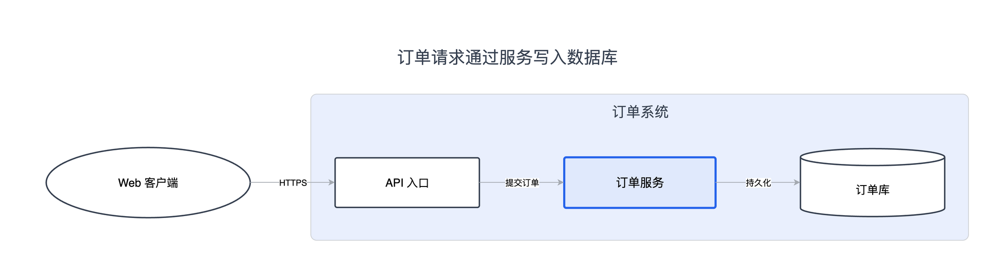
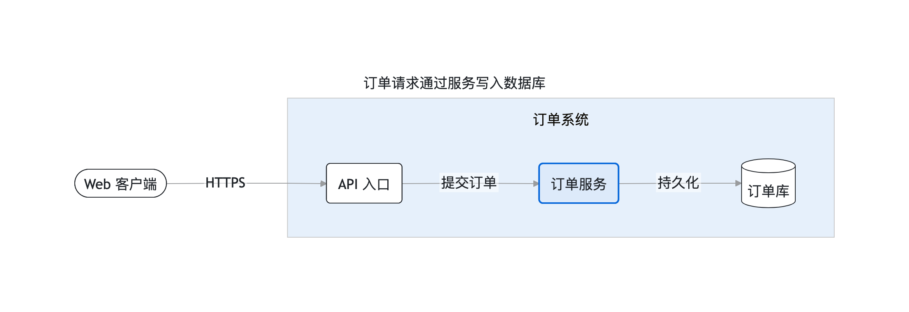

# diagram-authoring

> 从结构规格生成可编辑的技术图：架构、依赖、流程、状态、思维导图和网络拓扑。

| 适合 | 产物 | 依赖 |
| --- | --- | --- |
| 系统 / 流程 / 状态 / 拓扑 → 可编辑技术图 | `.excalidraw` · `.drawio` · `.mmd` · PNG / SVG | Python 3.10+；官方导出另需浏览器或 draw.io |

模型理解节点与关系；Python 负责布局、路由、检查和序列化。

<details>
<summary><strong>目录</strong></summary>

- [成品示例](#成品示例)
- [安装与依赖](#安装与依赖)
- [作图前逐步确认](#作图前逐步确认)
- [表达与观看](#表达与观看)
- [自由配色](#自由配色)
- [快速开始](#快速开始)
- [质量边界](#质量边界)
- [开发验证](#开发验证)
- [Mermaid 与 draw.io 的补齐](#mermaid-与-drawio-的补齐)

</details>

## 成品示例

同一份虚构的订单系统规格（[source.diagram.json](examples/architecture/source.diagram.json)），
三个后端各自计算布局。节点、连接、分组都来自规格，不是手工摆放的坐标。


**Excalidraw（默认）**：editorial 视觉，轻边框与手写感字体；产物是可继续编辑的 `.excalidraw`。



**draw.io**：同一份规格换成 classic 表现；需要 draw.io 协作或图标库时使用，产物是 `.drawio`。



**Mermaid**：规格先生成 `.mmd`，再交给官方解析器/渲染器；适合嵌进 Markdown 与文档流水线。

三张图来自 `examples/` 的虚构案例，不含客户数据；后端不同，布局与字体不要求像素一致。

## 安装与依赖

从仓库根目录安装：

```sh
python3 tools/install_skills.py
```

核心生成链只用 Python 标准库。可选工具各有依赖：

| 功能 | 依赖 |
| --- | --- |
| 自研布局预览 `dev-tools/preview.py` | Pillow |
| Excalidraw 官方 PNG/SVG 导出 | Chrome/Chromium 等受支持浏览器；加载官方 JS 包需要网络 |
| Mermaid 官方语法检查与 PNG/SVG 导出 | Chrome/Chromium；固定版本 Mermaid ESM 加载需网络 |
| draw.io PNG/SVG/PDF/JPG 导出 | draw.io 桌面版，支持 `DRAWIO_BIN` / `--binary` 指定路径 |
| 官方图标库搜索/下载 | 网络；缓存默认在 `~/.agent-skills/data/diagram-authoring/libraries/` |

## 作图前逐步确认

默认按内容 → 配色 → Excalidraw 图标逐项提交具体方案，每个节点等用户回复后再继续，最后生成。
draw.io/Mermaid 确认内容与配色，图标按当前能力标记为不适用；用户要求图标时先核对后端。
已确认且未变化的选择沿用，明确免确认的授权按其范围执行。参见 [逐步确认](references/decision-gates.md)。
这是代理对话流程；底层 CLI 保持非交互，不伪称脚本能验证人类确认。

## 表达与观看

先明确读者问题，按 [表达模式](references/semantic-patterns.md) 与 [图型规则](references/type-guides.md)
组织内容。`guide.py` 支持 `--pattern`、`--audience`、`--preset`；已有规格无需迁移。
Excalidraw/draw.io 生成器 `--preset` 支持文档、投影与打印字号/间距；默认 fit 保持旧输出。
语义检查提示遗漏，观看检查估算字号，官方 SVG 检查测量真实渲染；三者均不改事实。
一张图承载多个阅读问题时，先写视图计划再用 `split_views.py` 提取，保留全部原始节点与边并生成覆盖回执，
见 [阅读视图](references/reading-views.md)。需要同一画布内横竖混排时，用 `compose_panels.py` 做面板式组合，
每个面板独立布局，跨面板连线不自动生成；见 [混合方向](references/mixed-direction.md)。
[标准样例](examples/README.md) 提供六类输入、可编辑产物与实际导出。

## 自由配色

三后端支持 `--colors 项目.colors.json`，可使用任意 HEX、自由增添命名色，按节点角色或 ID 分配，
并调整填充强度。颜色可来自网站、参考图、品牌材料或 `color_design.py --seed` 的任意主色候选。
旧方向和方案保持兼容，不限制新设计。见 [配色方法与文件格式](references/color-design.md)、
[三种来源的同图实测](examples/colors/README.md)。

## 快速开始

适用节点确认后在 skill 目录运行；规格示例和字段见 [diagram-spec.md](references/diagram-spec.md)：

```sh
python3 scripts/validate_spec.py /project/docs/diagrams/system/.source/system.diagram.json
python3 scripts/check_semantics.py /project/docs/diagrams/system/.source/system.diagram.json --json
python3 scripts/emit_excalidraw.py /project/docs/diagrams/system/.source/system.diagram.json --quality showcase
python3 dev-tools/sync_exports.py /project/docs/diagrams/system/system.excalidraw
# 需要 draw.io 时替换上一条，不默认同时交付两种可编辑格式：
python3 scripts/emit_drawio.py /project/docs/diagrams/system/.source/system.diagram.json --quality showcase
python3 dev-tools/sync_exports.py /project/docs/diagrams/system/system.drawio
python3 scripts/check_presentation.py /project/docs/diagrams/system/system.excalidraw --preset doc-inline --json
```

新图默认一图一目录：外层只放可编辑文件，规格与配色放 `.source/`；不主动生成 PNG/SVG，
只提示用户需要时可导出。更新后通过 `sync_exports.py` 刷新已有格式，无已有图片则不调用导出器。
报告和试稿放临时目录，不例行附送 README 或展示页。详见 [文件组织](references/delivery-files.md)。
直接位于 `.source/` 的 `system.diagram.json` 默认生成上级 `system.excalidraw` / `system.drawio`；
其他输入保留旧规则（同目录只换最后后缀），`-o` 可指定任意输出路径。保留 spec，修改结构后重新生成。
同一输入、同一版本与素材生成确定性文件；手工编辑源成品的变化不会自动读回 spec。

| 工具 | 用途 |
| --- | --- |
| `scripts/guide.py` | 按表达模式、图型信号、受众与观看场景推荐起手方案 |
| `scripts/check_semantics.py` | 分支、状态、树关系与重点的审稿提示 |
| `scripts/check_presentation.py` | 成品名义字号的观看尺寸估算；不替代渲染 |
| `scripts/check_layout.py --json` | 布局诊断、自动调参回执 |
| `scripts/check_drawio.py` | draw.io XML 结构检查（含压缩页） |
| `scripts/readable_routing.py` | Excalidraw 密集图的近距离平行线、实际交叉与标签间隔检查（原生几何） |
| `scripts/layout.py --explain` | 开发时查看布局推导 |
| `scripts/emit_mermaid.py` / `check_mermaid.py` | 结构规格 → `.mmd`，并用官方解析器校验语法 |
| `scripts/direction_preview.py` / `scheme_preview.py` | 按需比较视觉方向或 draw.io 配色 |
| `scripts/compose_panels.py` | 把多张已生成的 Excalidraw 按 row/column 拼到同一画布，隔离 ID 与引用 |
| `scripts/sigils.py` / `icons.py` / `icons_fetch.py` | 内置图标、本地素材和官方库查询 |
| `dev-tools/export_excalidraw.py` / `export_drawio.py` / `export_mermaid.py` | 调用真实渲染器导出 |
| `dev-tools/sync_exports.py` | 只刷新已有格式；显式 `--format` 才新增格式，保存导出参数 |
| `dev-tools/check_render.py` | 在真实浏览器核对单页官方 SVG；能力与限制见观看场景 |

默认 Excalidraw；draw.io 支持多份 spec 合成多页文件。两者共有七种基本形状，
但 draw.io 当前拒绝图标、不支持完整云/UML/BPMN图元库。不要把“应用本身支持”当成“本生成器支持”。

## 质量边界

`standard` 允许部分连线警告；`showcase` 将结构类警告升级为阻塞。
阻塞时 emit 不写成品，已有文件不会被半成品覆盖。默认仅交付原生图时不强制导出做检查，
未做真实渲染审查须如实说明；Excalidraw 可能重新折行，字体与应用版本也可能改变结果。

默认在当前项目交付文件，不自动写 Obsidian。用户指定 vault 后才解析环境变量
`OBSIDIAN_VAULT_PATH` 或 `~/.agent-skills/config/obsidian-vault-path`。

详见 [使用入口](SKILL.md)、[校验](references/validation.md) 与两份后端说明。
`evals/evals.json` 覆盖代理行为；`benchmarks/first-pass/` 保留首轮可用性的协议、验证器与历史证据，
历史截图不代表当前版本已通过视觉验收。

## 开发验证

从仓库根目录执行（测试包含核心不变量与外部导出的 mock 合同）：

```sh
python3 -m unittest discover -s tests/diagram-authoring -v
```

浏览器/应用实际导出需单独运行并检查产物；单元测试通过不能替代它。

## Mermaid 与 draw.io 的补齐

`emit_mermaid.py` 从结构规格生成 `.mmd`，`check_mermaid.py` 用官方解析器校验；
PNG/SVG 由 `dev-tools/export_mermaid.py` 按需导出，已有格式通过 `sync_exports.py` 刷新：

```sh
python3 scripts/emit_mermaid.py system.diagram.json -o system.mmd
python3 scripts/check_mermaid.py system.mmd
python3 dev-tools/export_mermaid.py system.mmd -o system.png --format png
```

详见 [Mermaid 后端](references/mermaid-backend.md)。
draw.io 支持压缩文件回读、默认名义留白 80，多页图片需显式页码，PDF 默认全部页。
