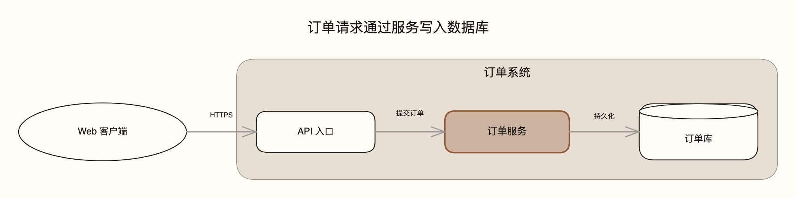
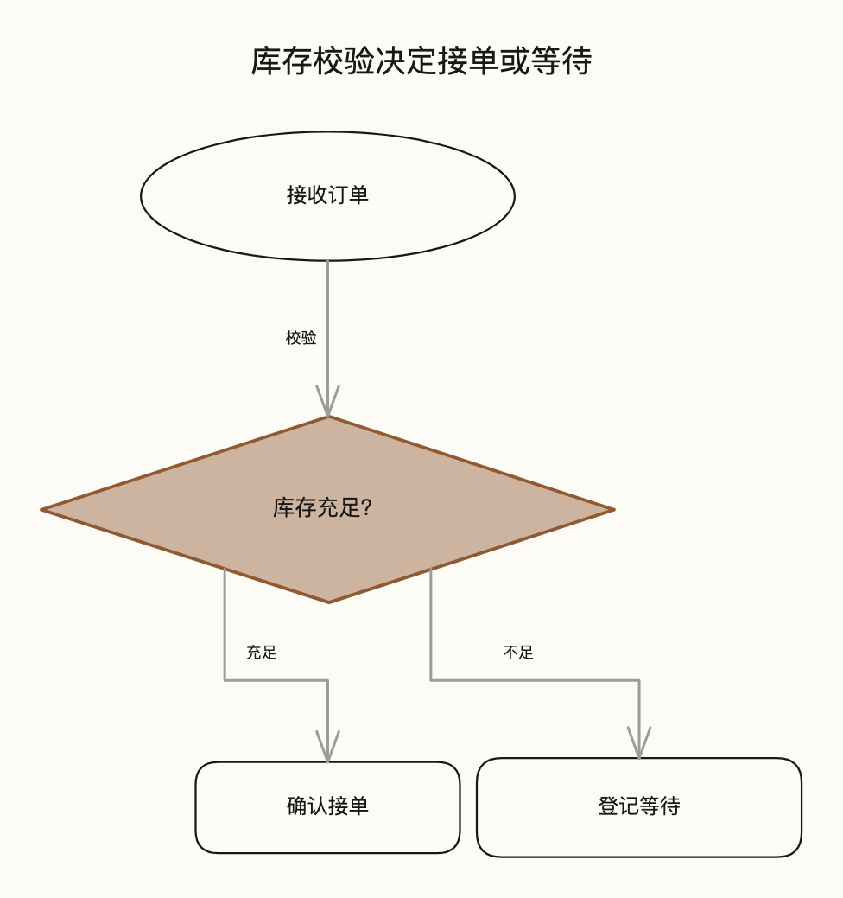
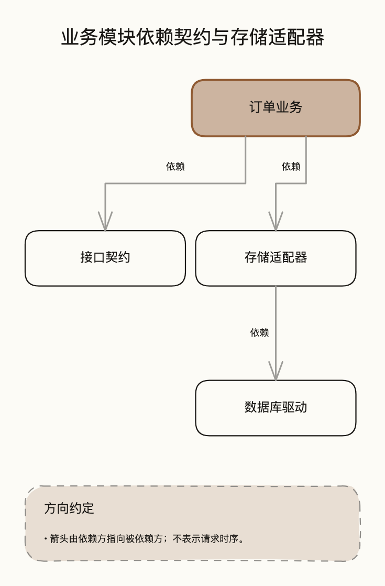
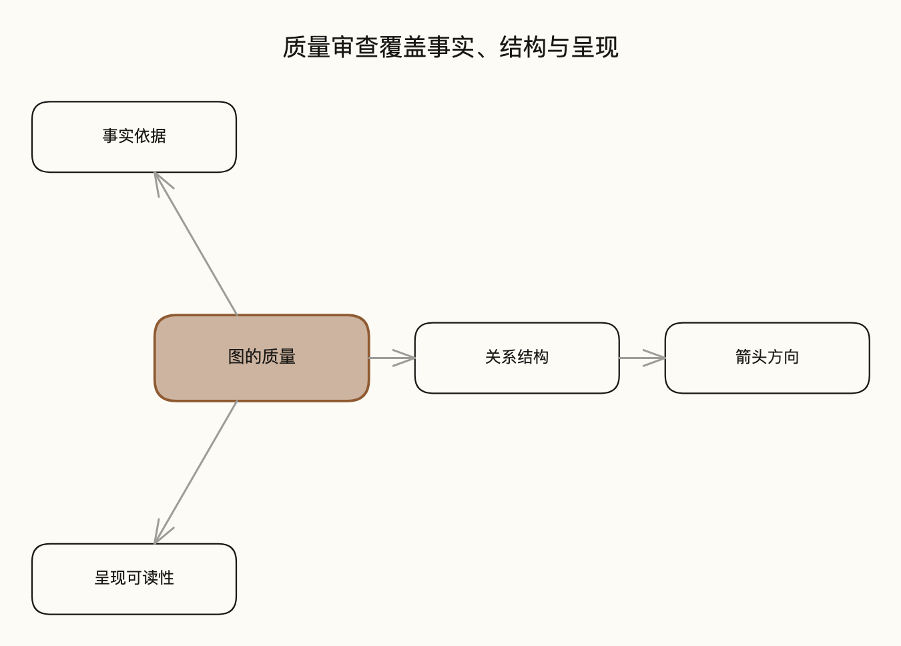
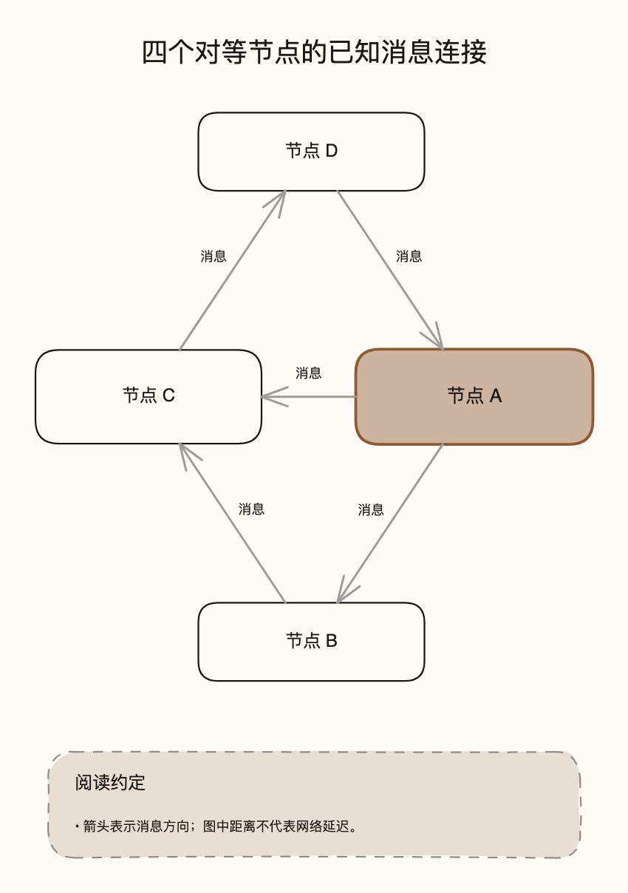

# 六类标准样例

> [← 返回 diagram-authoring](../README.md)

这些是本项目新写的虚构案例，用于学习图型语义、复查生成器和比较后端，不来自客户系统。
每例有一个明确的阅读问题，保留源规格、至少两种可编辑文件、官方导出图片及检查回执
（架构例另有 Mermaid 后端产物，用于同一规格的三后端对照）。
起手时参考同类样例的表达方式，不把样例布局当作当前材料的事实。

新增 [同规格文档／投影对照](presentation/README.md)，展示生成字号、间距和真实导出检查。

## 索引

| 图型 | 读者问题 / 必须读到的关系 | 建议观看场景 | 规格与可编辑文件 |
| --- | --- | --- | --- |
| 架构 | 请求在哪里处理和保存？客户端 → API → 订单服务 → 库；客户端在系统边界外 | doc-wide | [规格](architecture/source.diagram.json) · [Excalidraw](architecture/diagram.excalidraw) · [draw.io](architecture/diagram.drawio) · [Mermaid](architecture/mermaid.mmd) |
| 流程 | 库存不足怎么办？校验后分别走接单和等待，两条边都有条件 | doc-inline | [规格](flow/source.diagram.json) · [Excalidraw](flow/diagram.excalidraw) · [draw.io](flow/diagram.drawio) |
| 依赖 | 业务依赖什么？业务依赖契约及适配器，适配器依赖驱动 | doc-inline | [规格](dependency/source.diagram.json) · [Excalidraw](dependency/diagram.excalidraw) · [draw.io](dependency/diagram.drawio) |
| 状态 | 如何审核和退回？提交指向审核，退回指向草稿，通过后发布，再归档 | doc-wide | [规格](state/source.diagram.json) · [Excalidraw](state/diagram.excalidraw) · [draw.io](state/diagram.drawio) |
| 脑图 | 质量包含什么？事实、结构、呈现为三个分支，方向属于结构 | doc-inline | [规格](mindmap/source.diagram.json) · [Excalidraw](mindmap/diagram.excalidraw) · [draw.io](mindmap/diagram.drawio) |
| 网络 | 谁向谁发消息？A→B→C→D→A，并有 A→C | doc-inline | [规格](network/source.diagram.json) · [Excalidraw](network/diagram.excalidraw) · [draw.io](network/diagram.drawio) |

宽横图在 doc-inline 下会产生小字提示，不能靠提高 PNG 倍率消除。这里选 doc-wide，
并不证明它们适合投影。本页六例保留旧默认输出，建议场景只用于估算；
新增对照样例使用 `--preset` 重新测量、排版，并分别检查。

## 图片与阅读重点

### 架构：边界与处理顺序

[draw.io 图片](architecture/drawio.png)；Mermaid 后端另有 [.mmd](architecture/mermaid.mmd) 与 [PNG](architecture/mermaid.png)。
强调订单服务；分组只表达系统边界，不代表部署主机。
没有编造副本数、负载、缓存或容灾。中文标签与 Web / API / HTTPS 混排。

### 流程：分支结果

[draw.io 图片](flow/drawio.png)。判断必须有可区分的结果；“不足”通向等待。
连线接到菱形实际边缘。这里只覆盖接单判断，不声称是完整订单生命周期。

### 依赖：明确箭头含义

[draw.io 图片](dependency/drawio.png)。箭头从依赖方指向被依赖方；说明卡片不遮挡节点。
数据库驱动是软件节点，不用数据库圆柱形暗示它保存数据；这张图不表示调用时间顺序。

### 状态：返回边不改变方向

[draw.io 图片](state/drawio.png)。同一对节点的两个方向保留独立事件标签。
归档只是业务状态，不伪装成专用终态。自环及 UML 开始/结束语义尚未实现。

### 脑图：分解而非时间

[draw.io 图片](mindmap/drawio.png)。第一节点为根，子节点只有一个父节点；箭头表示分解。
径向距离和分支角度不编码重要性，真实多父或环关系应改选依赖图/网络图。

### 网络：保留全部已知连接

[draw.io 图片](network/drawio.png)。四个节点、五条有向连接均保留；距离不表达延迟。
这里只展示小型网络，不能据此承诺密集网络始终没有交叉。

## 证据与维护

2026-10-16 由作者代理逐张审查当时 12 张官方 PNG：节点和关系数量、方向、标签、
边界、重点及明显裁切/遮挡。2026-10-20 增加架构例的 Mermaid 导出（同一虚构规格），
只用于后端对照，未纳入上述逐张审查。本轮属于作者自检，未进行独立盲评，也没有量化字体渲染测试。
Excalidraw 使用 editorial，draw.io 使用 classic；两后端呈现不同，不要求像素一致。
渲染环境为 macOS、draw.io 31.4.5、Chrome 154.0.8037.98、固定的
`@excalidraw/utils@0.1.5`。中文使用本机字体回退，尚未记录实际解析字体，跨机器可能不同。

每个目录包含：

- `generation.json`：两后端 showcase 生成诊断；其中 perception pending 是生成时状态。
- `semantics.json`：可观察语义检查，未核验外部事实。
- `presentation.json`：名义字号及观看尺寸估算，`render_verified: false` 是此检查器的能力边界。
- `render.json` / `render-excalidraw.json`：官方导出回执；不是自动视觉评分。
- [manifest.json](manifest.json)：文件与生成器哈希、此后完成的目视审查记录。

在 skill 目录执行 `python3 dev-tools/check_examples.py` 检查清单一致性。
它只核对文件身份与已有记录，不重新渲染或自动批准视觉质量。

修改源规格或生成器后，按以下顺序维护：重新生成两种文件（showcase，draw.io 指定 classic），
运行语义及观看检查，使用官方导出器更新图片，逐张复查，再更新清单与审查记录。
没有实际检查的记录保持 pending，不允许仅更新哈希来跳过审查。

## 自由配色对照

[网站参考、单主色和自主深色](colors/README.md) 使用同一结构，两后端官方渲染。
具体颜色由项目文件给出；这些是输入示例，不是新的固定主题菜单。

[分区底色示例](regions/README.md) 演示三个独立浅色区域与中性节点，两后端采用同一项目配色。
