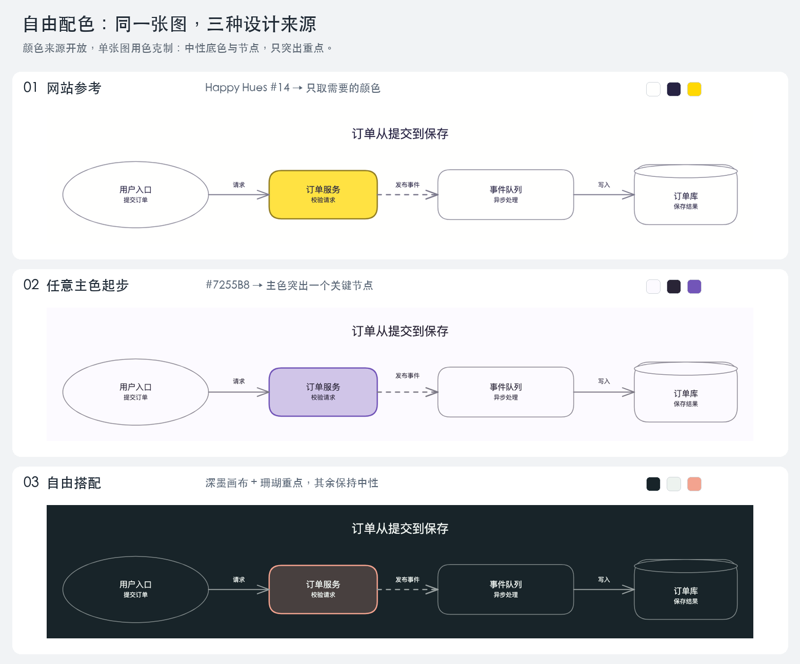

# 自由配色：三种来源的同图实测

日期：2026-10-16。三个文件是独立设计示例，**不是新加入的固定 profiles**。
可直接换任意 HEX、增加命名色、调整节点分配和填充强度，无需修改技能代码。



[查看双后端完整图集](gallery.html)。比较图来自官方 PNG，缩放拼接仅为展示；
按原图检查阅读细节。三个方案的结构、标签、字体与布局相同，均使用 doc-wide。

| 来源 | 项目配色 | 实际 Excalidraw | 实际 draw.io |
| --- | --- | --- | --- |
| [Happy Hues #14](https://www.happyhues.co/palettes/14) | [网站参考](website.colors.json) | [PNG](website-excalidraw.png) / [源文件](website.excalidraw) | [PNG](website-drawio.png) / [源文件](website.drawio) |
| 任意主色 `#7255B8`，伴随色角度 135 / 205 | [单色起步](brand.colors.json) | [PNG](brand-excalidraw.png) / [源文件](brand.excalidraw) | [PNG](brand-drawio.png) / [源文件](brand.drawio) |
| 作者自主搭配深墨和珊瑚重点 | [自由深色](custom-dark.colors.json) | [PNG](custom-dark-excalidraw.png) / [源文件](custom-dark.excalidraw) | [PNG](custom-dark-drawio.png) / [源文件](custom-dark.drawio) |

网站例实际读取其画布 `#FFFFFE`、文字 `#272343`、亮黄 `#FFD803`、青绿 `#BAE8E8`、
浅青 `#E3F6F5`；本图只采用画布、文字和亮黄重点，青绿候选保留在文件中但不用于节点；
填充强度及对比度调整为本项目适配。
未复制网页布局或插画；警示色另行设置。另两例不声称来自外部网站。

结构是本仓库创作的虚构订单处理链，不代表真实生产系统。
按用户“单图色彩过多会杂乱”的反馈，三图均以中性节点为主，只强调订单服务。
by_kind 留空，候选伴随色不会自动用于节点。入口、服务、队列和数据库仍有名称/形状，异步边仍用虚线。

## 复现

从 skill 目录执行，替换颜色文件即可使用任何新设计：

```sh
python3 scripts/color_design.py examples/colors/website.colors.json
python3 scripts/emit_excalidraw.py examples/colors/source.diagram.json --colors examples/colors/website.colors.json --preset doc-wide --quality showcase -o /tmp/color.excalidraw
python3 scripts/emit_drawio.py examples/colors/source.diagram.json --colors examples/colors/website.colors.json --scheme classic --preset doc-wide --quality showcase -o /tmp/color.drawio
```

真实渲染使用 `dev-tools/export_excalidraw.py` / `export_drawio.py`，不是内部 preview。
各 `*-export.json` 保存导出回执，`*-check.json` 保存浏览器测量的 SVG 检查，
`*-contrast.json` 保存解析后的纯色色值检查及派生调整。

六张 PNG 由作者逐张目视核对：四节点、三条边、标题和各标签完整，无明显裁切；
深色文字可读，重点色明确、普通节点保持中性。SVG 检查均 pass。
这不是独立盲评、PNG/SVG 像素一致性证明，也不覆盖图标、嵌套区域或完整无障碍验收。
配置、源文件、实际渲染和回执均纳入上一层清单的哈希校验。
