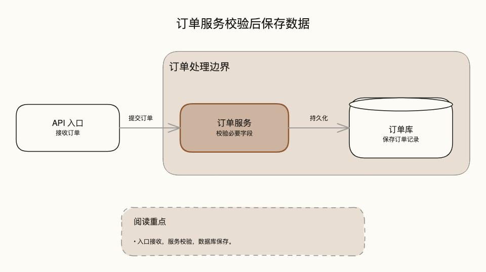
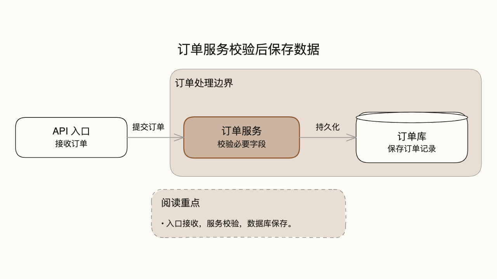
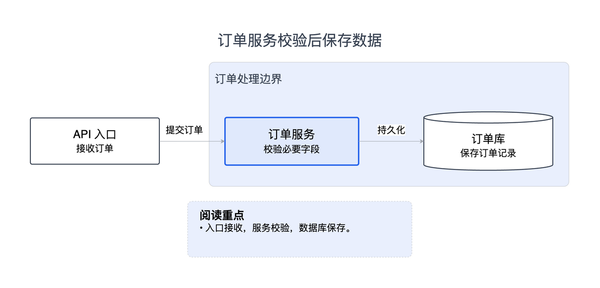

# 同一份规格：文档与投影

本项目虚构的订单处理案例，阅读问题是“订单数据在哪里校验和保存？”。
两版保留完全相同的三个节点、两条关系、区域、说明和结论卡片。
[源规格](source.diagram.json) 中没有坐标或像素字号；生成参数选择观看场景。

| 角色 | 文档 doc-wide | 投影 slide-16x9 |
| --- | --- | --- |
| 节点基本字号 | 16 | 24 |
| 说明及边标签 | 12 | 20 |
| 图标题 | 24 | 32 |
| 区域标题 | 20 | 24 |
| 节点 / 层间距起始值 | 120 / 120 | 90 / 90 |

这些是生成设计值，强调节点可再大一步。真实观看值取决于画布和嵌入尺寸，
不是把 PNG 放大就算优化。投影版会重新测量盒子与连线位置，不修改输入事实。

## Excalidraw

文档版：



投影版：



[文档可编辑文件](document.excalidraw) · [文档 SVG](document-excalidraw.svg) ·
[投影可编辑文件](slide.excalidraw) · [投影 SVG](slide-excalidraw.svg)

## draw.io



[文档 PNG](document-drawio.png) · [文档可编辑文件](document.drawio) · [文档 SVG](document-drawio.svg) ·
[投影可编辑文件](slide.drawio) · [投影 SVG](slide-drawio.svg)

Excalidraw 投影 PNG / SVG 为 1280×720；draw.io 保留自然内容比例，未声称补满 16:9。
两个后端各用其支持的文字机制；draw.io 显式场景使用 HTML span 表达较小的节点说明与较大的卡片标题。

## 本轮验证

2026-10-16：四张 PNG 经作者目视复核，四份 SVG 经真实 Chrome 测量。
对应 `*-export.json` 保存官方导出结果，`*-check.json` 保存检查结果及源文件 / SVG 哈希。
文档最小观看字号为 12px；投影 Excalidraw 为 22.81px、draw.io 为 20px。
字体可用性只检查声明字体；不证明每个汉字的具体回退字体，也不证明 PNG 与 SVG 像素一致。

另外用流程图进行了真实坏例验证：裁切、删除文字、删除箭头头部、指定不存在字体均被检出。
这些验证不覆盖节点内部裁切、遮挡、编辑后的重排或所有主题。图片与清单不能替代新产物验收。

## 复现

从 skill 目录运行，先生成，再导出，再检查：

```sh
python3 scripts/emit_excalidraw.py examples/presentation/source.diagram.json --preset slide-16x9 --quality showcase -o /tmp/order-slide.excalidraw
python3 dev-tools/export_excalidraw.py /tmp/order-slide.excalidraw -o /tmp/order-slide.png --svg /tmp/order-slide.svg --scale 1 --width 1280 --height 720 --padding 40
python3 dev-tools/check_render.py /tmp/order-slide.excalidraw /tmp/order-slide.svg --preset slide-16x9 --width 1280 --height 720 --json
```
