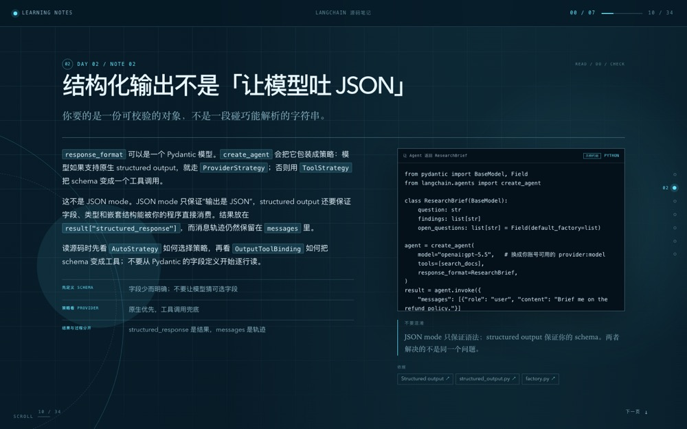

# learning-scout

把一个学习需求变成一份**可离线打开的 HTML 学习笔记**：有路线、有解释、有源码/例子、
有动手步骤、有测验、有间隔复习，还有只存在本机的进度与续读。不是 Markdown 链接清单，
也不是课程目录的搬运。

版式不是只换颜色。当前主样张是逐页笔记：

|  |
| --- |
| paged · 一屏一页、滚动吸附、视差背景 |

## 依赖

- Python 3.11+，只用标准库。
- 研究阶段需要可用的网页搜索/抓取工具；渲染本身不联网。
- 生成的 HTML 自包含 CSS、JS 和内容，不需要安装前端依赖。

## 目录

| 文件 | 作用 |
| --- | --- |
| `SKILL.md` | Agent 的工作流程、来源规则和验收标准 |
| `scripts/learning_scout.py` | JSON 校验、HTML 渲染、版式/主题和原子写入 |
| `templates/page.html` | journey / atlas / studio 页面结构 |
| `templates/page-paged.html` | paged 笔记结构：封面、章节、笔记、练习、测验、复习 |
| `assets/learning.css` | journey / atlas / studio 三套基础版式、四套主题、响应式与打印 |
| `assets/paged.css` | 一屏一页、滚动吸附、视差、测验与复习样式 |
| `assets/paged.js` | 续读、完成、测验、复习评分、导出 Markdown |
| `assets/learning.js` | journey / atlas / studio 的进度保存、筛选和滚动揭示 |
| `references/plan-schema.md` | JSON 字段和校验规则 |
| `references/content-quality.md` | 讲义式正文的内容合同、全面性与清晰度检查 |
| `references/source-quality.md` | 博客/视频/社区来源的分层与核验 |
| `references/learning-design.md` | 非固定五栏的路线设计方法 |
| `examples/rag.plan.json` | 一份真实的 RAG 学习路线示例 |
| `examples/langchain.plan.json` | 一份 7 天 LangChain 源码路线 |
| `examples/langchain-notes.plan.json` | 一份 34 页、15 篇笔记的 LangChain 跟读示例 |
| `examples/paged-preview.jpg` | paged 逐页笔记预览 |

## 快速使用

```sh
# 只校验
python3 scripts/learning_scout.py validate --input examples/rag.plan.json

# 渲染并打开：默认写到下载目录
python3 scripts/learning_scout.py render --input examples/rag.plan.json --open

# 指定输出文件
python3 scripts/learning_scout.py render \
  --input examples/rag.plan.json \
  --out ~/Downloads/rag-learning.html

# 只打印 HTML
python3 scripts/learning_scout.py render --input examples/rag.plan.json --stdout
```

默认输出：

- macOS/Linux：`~/Downloads/learning-scout/<topic>-<date>/index.html`
- Windows：`%USERPROFILE%\Downloads\learning-scout\<topic>-<date>\index.html`

可以用 `--output-dir` 或环境变量 `LEARNING_SCOUT_OUTPUT_DIR` 换目录。
`--layout` 控制结构（`journey` / `atlas` / `studio` / `paged`），`--theme`、`--accent`、`--motif`
控制视觉。切换 `--theme` 时默认使用该主题自己的强调色和背景 motif；
需要混搭时再显式传 `--accent` / `--motif`。

```sh
# 目录式双栏
python3 scripts/learning_scout.py render --input examples/rag.plan.json --layout atlas

# 海报 + 卡片墙
python3 scripts/learning_scout.py render --input examples/langchain.plan.json --layout studio

# 一屏一页、带测验和复习的完整笔记
python3 scripts/learning_scout.py render --input examples/langchain-notes.plan.json --open
```

## 输入

学习笔记是一个 JSON 文件。不是每个阶段都必须有“目标 / 资源 / 练习 / 检查点 / 时间”
五栏；字段有就渲染，没有就省略。`paged` 版式额外支持 `learner`、`sections`、
`quiz`、`review`、`practice.steps`；完整字段见
[references/plan-schema.md](references/plan-schema.md)。

```json
{
  "version": 1,
  "topic": "RAG 实战",
  "title": "从开卷考试到可评估系统",
  "title_lines": ["从开卷考试", "到可评估系统"],
  "promise": "不是把文档塞进 prompt，而是造一台会找、会答、会认错的机器。",
  "theme": { "name": "deep-field", "motif": "orbit", "accent": "#c8ff4d" },
  "stages": [
    {
      "id": "s1",
      "title": "先把 RAG 看成一场开卷考试",
      "resources": [
        {
          "title": "Introduction to RAG",
          "url": "https://developers.llamaindex.ai/python/framework/understanding/rag/",
          "format": "docs",
          "source": "LlamaIndex Docs",
          "tier": "primary",
          "why": "建立工程词汇表。",
          "time": "20 分钟"
        }
      ],
      "practice": { "title": "画一张自己的 RAG 流水线" },
      "checkpoint": { "question": "检索差时先怪模型吗？" }
    }
  ],
  "sources": {
    "verified_at": "2026-10-22",
    "note": "链接核验于 2026-10-22。"
  }
}
```

必填项只有 `version`、`topic`、`promise`、`stages` 和 `sources.verified_at`。
每个阶段至少要有资源、练习或检查点之一；整条路线至少有一个动手任务。

`paged` 的每个阶段还需要 `sections`，每篇至少要有正文、要点或代码之一；正文先解释，
旁边放 `sources`，阶段末放 `quiz`。整条路线可放 `review` 卡片，按 1 / 3 / 7 天复习。

## 版式

- `journey`：星图 + 纵向阶段，适合从概念走到项目。
- `atlas`：目录式双栏，阶段标题在左、内容在右，适合资料多、查阅型路线。
- `studio`：海报式开场 + 卡片墙，适合源码、工程项目和多天集训。
- `paged`：一屏一页、滚动吸附、视差背景；适合“从第一页读到最后一页”的系统笔记。

版式决定结构，主题决定颜色/材质；两者可以组合，不要只换颜色。

## 主题

- `deep-field`：深色 + 荧光绿，适合 AI、研究、前沿技术。
- `paper-trail`：暖纸色 + 衬线，适合人文、写作、产品。
- `citrus`：明亮 + 橙色，适合设计、前端、创意。
- `blueprint`：深蓝 + 青色，适合系统、基础设施、工程。

`motif` 可选 `orbit`、`grid`、`waves`、`bloom`。不指定主题时按主题词自动选择。
主题共享组件，版式改变结构：`journey` 是星图纵向路线，`atlas` 是目录式双栏，
`studio` 是海报 + 卡片墙。主题和版式可以组合，不要只换颜色。

## 页面能力

- 顶部阅读进度（页码 + 已完成章节），进度保存在浏览器本地。
- 阶段导航、资源架、按资源类型筛选（journey/atlas/studio）。
- `paged`：一屏一页、滚动吸附、视差背景、每页依据链接。
- 每个阶段有动手步骤（do / expect / check）和 2–5 道回忆题。
- 测验即时反馈；答错进入薄弱点，导出时可见。
- 复习卡按 1 / 3 / 7 天评分，记录到期日。
- 关闭后再次打开可“继续上次”；可导出 `progress.md`。
- 桌面和手机响应式；支持打印/保存 PDF。
- 不加载远程字体、脚本或图片；断网也能打开。

## 验证

```sh
python3 -m unittest discover -s tests/learning-scout -v
python3 skills/skill-builder/scripts/validate_skill.py skills/learning-scout
```

视觉验收至少看 1440px 桌面和 390px 手机；检查标题拆词、横向溢出、筛选、
勾选和外链。渲染器校验通过不代表资料内容正确；来源质量仍由研究者负责。

## 限制

- 不自动抓取或验证链接；核验发生在研究阶段，结果写进 `sources.verified_at`。
- 进度、测验答案和复习安排只写在 `localStorage`；换设备、换浏览器或清缓存会丢失。
- 不下载、转录、重新分发付费课程和视频。
- 不自动写入任何知识库；是否沉淀由用户决定。
- 不把没有看过的视频写成“看过了”，也不把元数据当成内容评价。
- 不承诺“保证学会”或固定天数精通。
